# 🛡️ Awesome Active Directory & Entra ID Protection ☁️

  
  
  
  
  
  

**Curated collection of SaaS products and production-tested open-source security tools for Active Directory (AD) Forest Recovery, Microsoft Entra ID (Azure AD) Backup, Identity Threat Detection & Response (ITDR), Attack Path Analysis, and Directory Hardening.**

🌟 *Star this repository to bookmark the latest cyber resilience benchmarks and tooling updates!* 🌟

---

## 📑 Table of Contents

- [📊 Sector Overview & Market Dynamics](#-sector-overview--market-dynamics)
- [🏢 SaaS / Commercial Hosted Platforms](#-saas--commercial-hosted-platforms)
- [💻 Open-Source GitHub Projects](#-open-source-github-projects)
- [🤝 How to Contribute](#-how-to-contribute)
- [💖 Support](#-support)
- [📈 Star History](#-star-history)
- [⚠️ Disclaimer](#️-disclaimer)

---

## 📊 Sector Overview & Market Dynamics

The dedicated Active Directory (AD) protection and Identity Threat Detection and Response (ITDR) market is estimated at **$1.1B to $1.3B** (scaling rapidly toward **$3.8B+** by 2030, embedded within a broader **$5.6B–$16.6B** identity security sector). The market exhibits **moderate concentration**: broad cyber-resilience platforms (Veeam, Rubrik, Cohesity) and hyperscalers anchor foundational enterprise backup, while specialized pure-play vendors (Semperis, Netwrix, Cayosoft) dominate deep forest recovery, attack-path auditing, and directory posture management.

---

## 🏢 SaaS / Commercial Hosted Platforms

| 🏢 Company / Product | 📈 Scale (Valuation / Revenue) | 💳 Pricing (Specific Starting Tiers) | 🎁 Free Tier / Trial Limit | 🎯 Key Focus & Trade-off |
| :--- | :--- | :--- | :--- | :--- |
| **Veeam Explorer for Active Directory** | **$15B valuation** (~$1.7B ARR; TPG / Insight Partners) | Included with Veeam Universal License (VUL); starts at **$155/instance/year** (sold in 10-packs for $1,550/yr) | **Free-forever plan**: Veeam Community Edition provides free full backup/restore for up to **10 instances (workloads)** indefinitely. | **Best for**: Existing Veeam customers seeking native AD object restore. **Trade-off**: Requires Veeam infrastructure; advanced DR orchestration requires Premium tier. |
| **Rubrik Identity Resilience** | **~$13.9B market cap** (~$888M FY25 revenue; NYSE: RBRK) | Foundation Edition for SaaS / M365 starts at **$3.80/user/month** (3-year contract required; enterprise minimums apply) | **30-day free trial**: Available upon request for targeted workloads (e.g., Salesforce sandbox / M365 backup) and customized enterprise PoC. | **Best for**: Large enterprises needing tamper-resistant monitoring and 5-step forest recovery. **Trade-off**: High multi-year enterprise minimums. |
| **Cohesity Identity Resilience** | **~$8B valuation** (~$1.7B pro forma revenue post-Veritas merger) | DataProtect DPaaS starts at **$29,100/year** for 10 BETB (~$2,900/TB/yr); software subscription from **$150–$400/TB/year** | **30-day free trial**: Unrestricted trial available for Cohesity Data Cloud / DataProtect as a Service upon registration. | **Best for**: Cohesity/Veritas customers wanting integrated Semperis-powered AD resilience. **Trade-off**: High minimum capacity commitments (typically 10 TB BETB or 3-node cluster). |
| **Commvault AD Protection** | **~$6.6B market cap** (~$995.6M FY25 revenue; NASDAQ: CVLT) | SaaS Microsoft 365 / Identity backup starts at **$1.70/user/month** (Standard) to **$4.50/user/month** (Enterprise); infrastructure backup from **$58.50/TB/month** | **30-day free trial**: Commvault Cloud offers a fully functional 30-day trial covering hybrid cloud workloads and SaaS identity without credit card. | **Best for**: Enterprises consolidating directory, cloud, and SaaS backup on one platform. **Trade-off**: Broad platform footprint required for full directory recovery suite. |
| **Quest Recovery Manager for Active Directory (RMAD)** | **~$5.4B buyout valuation** (Acquired by Clearlake Capital; >$1B revenue) | Disaster Recovery term license lists at **$48.86/user/year** (CDW-G); maintenance renewal at **$73.80/user/year** | **30-day free trial**: Full-featured 30-day trial for Recovery Manager for Active Directory Disaster Recovery Edition. | **Best for**: Organizations wanting battle-tested AD forest backup and surgical attribute restoration. **Trade-off**: Scales per enabled user account; primarily recovery-focused rather than real-time posture defense. |
| **Druva SaaS Universal License** | **$2B peak valuation** (~$200M+ ARR; backed by Neuberger Berman / Riverwood) | User & SaaS workload backup starts at **$6.80 to $8.00/user/month** (Business to Enterprise); unmanaged infrastructure at custom TB-month rates | **30-day free trial**: 30-day full-access trial for Druva Data Resiliency Cloud with 300 GB pooled storage per user, no credit card required. | **Best for**: Cloud-first organizations consolidating endpoint, M365, and directory protection. **Trade-off**: Per-user pricing scales quickly across large workforces. |
| **Semperis Directory Services Protector (DSP)** | **~$1B valuation** (Surpassed $100M ARR; Series C / KKR) | Custom enterprise subscription based on protected active directory accounts (private offers via Azure Marketplace / Carahsoft NASA SEWP V) | **Free community tool**: Semperis **Purple Knight** is free forever for unlimited AD/Entra/Okta vulnerability scans (paid DSP offers 30-day enterprise proof-of-concept upon request). | **Best for**: Enterprises needing automated ransomware-free AD forest recovery and continuous posture remediation. **Trade-off**: Enterprise sales motion only; private offers tailored to user count. |
| **ManageEngine RecoveryManager Plus** | **~$580M–$600M annual revenue** (IT division of bootstrapped Zoho Corp, ~$1.5B revenue) | AD Standard Edition starts at **$475/year** (includes AMS for 250 objects); M365 backup starts at **$195/year** | **Free-forever plan**: 30-day fully functional trial, which automatically converts to **Free Edition** indefinitely (limited to 1 domain, scheduled backups only, no granular rollback). | **Best for**: SMBs and mid-market teams seeking low-cost, transparent directory and M365 protection. **Trade-off**: Granular object rollback and multi-domain environments require paid tiers. |
| **Netwrix Auditor for AD** | **~$200M+ est. revenue** (ARR grew 5x under TA Associates & Centerbridge Partners) | Essentials tier starts at **$20/enabled AD user + cloud-only Entra ID user/year** (self-service subscription) | **Free-forever plan**: 20-day unrestricted trial, which automatically reverts to **Free Community Edition** indefinitely (daily change summary reports via email). | **Best for**: Audit compliance, change tracking, and spotting unauthorized AD modifications. **Trade-off**: Auditing and posture detection platform, not a disaster recovery or backup restoration tool. |
| **Cayosoft Administrator & Guardian** | **Bootstrapped / $22.5M growth round** (Centana Growth Partners; 76% ARR growth) | Subscription licensing based on total managed directory objects (flat license covering unlimited administrators and servers; custom quote via Carahsoft GSA MAS #47QSWA18D008F) | **Free-forever plan**: Cayosoft Free Edition includes web portal, LAPS access, BitLocker recovery, and Graph PowerShell module; commercial editions offer **25-day free trial**. | **Best for**: Hybrid organizations wanting AD management and forest recovery without per-admin fees. **Trade-off**: Deep forest disaster recovery features reserved for Guardian paid tier. |

---

## 💻 Open-Source GitHub Projects

Sorted in descending order by GitHub stargazers count. Each repository includes direct links to documentation, source code, and its stargazers community.

### 1. 🔍 [BloodHound](https://github.com/SpecterOps/BloodHound) 
* **License**: Apache-2.0 | **Primary Tech**: Go, Neo4j, JavaScript, Docker
* **Overview**: The undisputed industry benchmark for identity risk management and attack path analysis. BloodHound uses graph theory to reveal unintended hidden permission relationships and privilege escalation routes in hybrid Active Directory and Microsoft Entra ID environments.
* **Key Capabilities**: Maps shortest attack paths to Domain Admins and Global Admins; simulates adversary movement; enables blue teams to surgically sever high-risk edge relationships before adversaries exploit them.
* **Limitations**: Analysis and posture auditing platform only; does not perform directory backup or object restoration.

### 2. 🏰 [PingCastle](https://github.com/netwrix/pingcastle) 
* **License**: Non-Commercial / Community Edition | **Primary Tech**: C#, .NET
* **Overview**: A widely respected, standalone Active Directory security auditing and risk assessment tool designed to quickly assess directory posture and calculate an organization's AD risk score.
* **Key Capabilities**: Discovers AD misconfigurations, obsolete objects, weak trust links, privileged account hygiene vulnerabilities, and anomalies; outputs actionable, color-coded executive reports and technical remediation roadmaps.
* **Limitations**: Point-in-time assessment engine; does not provide real-time protection or automated DC rollback.

### 3. 🤿 [ScubaGear](https://github.com/cisagov/ScubaGear) 
* **License**: CC0-1.0 (Public Domain) | **Primary Tech**: PowerShell
* **Overview**: Developed by the Cybersecurity and Infrastructure Security Agency (CISA), ScubaGear automates assessment of Microsoft 365 and Microsoft Entra ID tenant security baselines against CISA's Secure Cloud Business Applications (SCuBA) technical benchmarks.
* **Key Capabilities**: Verifies Entra ID Conditional Access policies, multi-factor authentication (MFA) enforcement, administrative role segregation, and tenant-level sharing permissions; generates interactive HTML compliance reports.
* **Limitations**: Focused on Microsoft 365 cloud identity configuration compliance rather than on-premises AD forest recovery.

### 4. 🗺️ [ROADtools](https://github.com/dirkjanm/ROADtools) 
* **License**: MIT | **Primary Tech**: Python, SQLAlchemy
* **Overview**: A rogue's exploration and auditing framework for Microsoft Entra ID (Azure AD), authored by researcher Dirk-jan Mollema.
* **Key Capabilities**: Dumps Entra ID data (users, devices, directory roles, service principals, Conditional Access rules) via internal Graph APIs into a local SQLite database, accompanied by a local web GUI (ROADrecon) for deep visual exploration of tenant permissions.
* **Limitations**: Read-only reconnaissance framework; provides data collection and visualization rather than configuration restoration.

### 5. 📚 [AzureAD-Attack-Defense](https://github.com/Cloud-Architekt/AzureAD-Attack-Defense) 
* **License**: Open Reference | **Primary Tech**: PowerShell, Markdown, Architecture Blueprints
* **Overview**: The most comprehensive open-source playbook for understanding Entra ID attack surfaces and operationalizing blue team hardening controls.
* **Key Capabilities**: Step-by-step mitigation recipes for token theft, Pass-the-PRT, consent grant abuses, service principal abuse, and administrative privilege escalation; maps each attack vector to actionable detection queries and hardening configurations.
* **Limitations**: Knowledge repository and implementation guidance rather than an autonomous automation platform.

### 6. 🐍 [BloodHound.py](https://github.com/dirkjanm/BloodHound.py) 
* **License**: MIT | **Primary Tech**: Python, Impacket, LDAP
* **Overview**: A cross-platform Python-based ingestor for BloodHound. Enables seamless collection of Active Directory and domain data directly from Linux, macOS, or containerized environments without relying on domain-joined Windows endpoints.
* **Key Capabilities**: Queries domain controllers using standard LDAP/SAMR/RPC; supports Kerberos and NTLM authentication; generates zip files ready for drag-and-drop into the BloodHound GUI.
* **Limitations**: Collector utility only; relies on BloodHound for visualization and path analysis.

### 7. 📜 [Microsoft 365 DSC](https://github.com/Microsoft365DSC/Microsoft365DSC) 
* **License**: MIT | **Primary Tech**: PowerShell, Desired State Configuration (DSC)
* **Overview**: Declarative configuration management tool backed by Microsoft that serves as the premier open-source blueprint for Entra ID tenant backup and automated configuration drift monitoring.
* **Key Capabilities**: Reverse-engineers tenant configurations into declarative code; exports and synchronizes users, groups, application registrations, and Conditional Access policies; continuously detects and self-corrects unintended tenant modifications.
* **Limitations**: Restores declarative tenant structure, but cannot restore encrypted credentials, secrets, or transactional state.

### 8. ⚡ [Adalanche](https://github.com/lkarlslund/Adalanche) 
* **License**: AGPL-3.0 | **Primary Tech**: Go, Embedded Graph Database, HTML5
* **Overview**: A lightning-fast, self-contained Active Directory and Azure AD ACL/permission visualizer that runs as a single zero-dependency binary without external database requirements.
* **Key Capabilities**: Queries Active Directory via LDAP, instantly constructs an in-memory graph, and serves an interactive web interface highlighting effective permissions, group nestings, and takeover paths in real time.
* **Limitations**: Focused purely on immediate visual ACL assessment; does not store continuous change histories or backups.

### 9. 🛠️ [DSInternals](https://github.com/MichaelGrafnetter/DSInternals) 
* **License**: MIT | **Primary Tech**: C#, PowerShell, .NET
* **Overview**: The most powerful open-source forensic and recovery framework for Active Directory. Developed by Michael Grafnetter, its engine exposes undocumented AD internal database formats (`ntds.dit`) and directory replication protocols.
* **Key Capabilities**: Bare-metal domain controller recovery from Install-From-Media (IFM) snapshots; offline manipulation of `ntds.dit` (password resets, group adjustments, LAPS key decryption, BitLocker key extraction); online DCSync replication; password hash auditing against compromised dictionaries.
* **Limitations**: Advanced low-level engine requiring deep AD administration expertise; erroneous use can cause irreparable directory damage.

### 10. ☁️ [AADInternals](https://github.com/Gerenios/AADInternals) 
* **License**: MIT | **Primary Tech**: PowerShell
* **Overview**: The quintessential PowerShell module for administering, forensic auditing, and security testing Microsoft Entra ID and Microsoft 365 internal APIs.
* **Key Capabilities**: Simulates hybrid identity flows; audits password hash synchronization (PHS) and Seamless SSO; inspects Kerberos realm configurations; identifies misconfigured federated trust relationships and OAuth enterprise application consent grants.
* **Limitations**: Highly capable dual-use administrative tool; requires strict administrative controls when running in production.

### 11. 🐦 [Sparrow](https://github.com/cisagov/Sparrow) 
* **License**: CC0-1.0 (Public Domain) | **Primary Tech**: PowerShell
* **Overview**: Forensic utility released by the Cybersecurity and Infrastructure Security Agency (CISA) Cloud Forensics team to assist incident responders in detecting identity compromise and unauthorized activity within Microsoft Entra ID and M365 environments.
* **Key Capabilities**: Scans unified audit logs for suspicious domain modifications, app role assignments, service principal credential additions, and unusual PowerShell logins; outputs categorized CSV records for investigation.
* **Limitations**: Post-incident forensic auditor; does not provide continuous telemetry or preventative access controls.

### 12. 🐕 [SharpHound](https://github.com/SpecterOps/SharpHound) 
* **License**: GPL-3.0 | **Primary Tech**: C#, .NET
* **Overview**: The official, high-performance C# data collector for BloodHound.
* **Key Capabilities**: Employs multi-threaded Windows API calls and LDAP queries to map enterprise domain controllers, local group memberships, active user sessions, ACL permissions, Object Owners, and Kerberos delegation settings.
* **Limitations**: Data ingestion collector only; data must be loaded into BloodHound for attack graph visualization.

### 13. 🐵 [Monkey365](https://github.com/silverhack/monkey365) 
* **License**: Apache-2.0 | **Primary Tech**: PowerShell
* **Overview**: A versatile security scanner and posture assessment tool for Microsoft 365, Microsoft Entra ID, and Azure environments.
* **Key Capabilities**: Inspects hundreds of tenant configuration controls across Entra ID, Exchange Online, and SharePoint; produces exhaustive security posture reports in HTML and JSON; maps findings directly to industry benchmarks (CIS, NIST).
* **Limitations**: Assessment engine focused on policy compliance rather than backup or disaster restoration.

### 14. 🔎 [PyADRecon](https://github.com/l4rm4nd/PyADRecon) 
* **License**: MIT | **Primary Tech**: Python
* **Overview**: Python-based Active Directory reconnaissance tool designed for red and blue teams assessing domain configuration vulnerabilities.
* **Key Capabilities**: Queries Active Directory Web Services (ADWS on TCP/9389) or standard LDAP; extracts comprehensive inventory of domain objects, OUs, trusts, SPNs, and password policies; exports comprehensive findings into structured Excel (`.xlsx`) workbooks.
* **Limitations**: Reconnaissance utility; does not execute continuous change protection or directory restore.

---

## 🤝 How to Contribute

We welcome community contributions, tool submissions, and updates!

1. 🍴 **Fork** the repository.
2. 🌿 **Create a new branch** (`git checkout -b feature/new-tool-entry`).
3. ✏️ **Add or edit entries** in `README.md` following the existing format (include license, tech stack, key focus, and GitHub Stars_Badge).
4. 🚀 **Commit your changes** (`git commit -m "Add NewTool to Open-Source section"`).
5. 📤 **Push to your branch** (`git push origin feature/new-tool-entry`).
6. 📬 **Open a Pull Request** with a brief summary of the project and why it belongs in this curated guide.

---

## 💖 Support

If you find this curated directory helpful for securing your organization's hybrid identity infrastructure, please consider supporting the project:

- 🌟 **Star the repository** to boost visibility and keep up with new security tools.
- 🍴 **Fork and share** the repo with fellow identity security engineers, sysadmins, and blue teamers.
- ☕ **Buy a coffee & sponsor**: Support continuous research and open-source maintenance via the [GitHub Sponsor Dashboard](https://github.com/sponsors/ishandutta2007).

Thank you for helping keep directory services and cloud identity infrastructure resilient and secure! 🚀

---

##  Saar History

---

## ⚠️ Disclaimer

- This repository is a **community-curated index** intended solely for educational, administrative, and defensive security engineering purposes.
- Tools that inspect internal directory databases (`ntds.dit`) or capture replication traffic (such as DSInternals or AADInternals) possess elevated privileged access; always obtain authorized written permission and test extensively in isolated lab environments prior to production usage.
- Hybrid identity resilience requires a multi-layered defense strategy: combine automated immutable backups with continuous attack path elimination and identity threat detection and response (ITDR).
